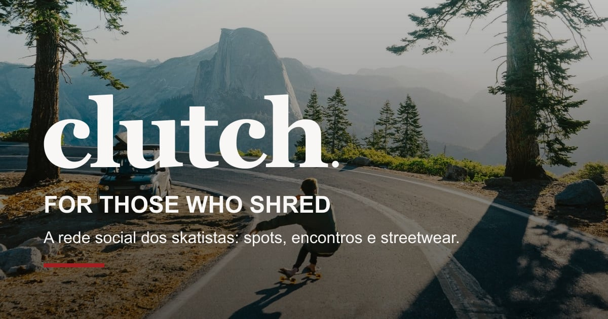
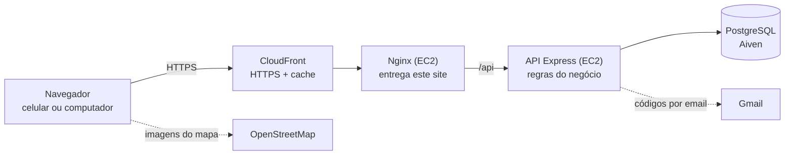

<div align="center">



# Clutch — Site (frontend)

**A rede social do skatista:** onde andar, com quem andar e o que vestir, em um só lugar.


Trabalho de Conclusão de Curso · turma DS2A · 2026<br>
**André Camacho · Gabriel Neri · Guilherme Sales · Tito Leal**

[Funcionalidades](#funcionalidades) · [Arquitetura](#arquitetura) · [Tecnologias](#tecnologias) · [Como rodar](#como-rodar) · [Testes](#testes) · [Publicação](#publicação-deploy)

</div>

---

## O projeto

O Clutch junta três coisas que o skatista hoje faz em lugares separados:

| | Frente | O que a pessoa faz |
|---|---|---|
| 🗺️ | **Explorar e Eventos** | Acha spots no mapa, sugere novos e marca encontros com a galera |
| 💬 | **Comunidade** | Posta sessões com fotos, comenta, segue outros skatistas e conversa com os amigos |
| 🛹 | **Market** | Compra streetwear e peças de skate, com carrinho e acompanhamento do pedido |

Este repositório é o **site**, feito em React. Ele conversa com a API do projeto:

| Repositório | O que é |
|---|---|
| **ProjetoTCC_WEB_REACTJS** (este) | Site em React + TypeScript |
| [ProjetoTCC_WEB_BACKEND](https://github.com/AndreCamacho-byte/ProjetoTCC_WEB_BACKEND) | API em Express, banco PostgreSQL e documentação Swagger |
| Terraform_TCC_WEB_REACT (privado) | Infraestrutura na AWS, criada por código |

## Funcionalidades

| Área | O que tem |
|---|---|
| **Conta** | Cadastro com @username e confirmação do email por código, login em duas etapas (senha + código por email), “lembrar este aparelho”, esqueci minha senha, foto de perfil, bio, nível de skate, troca de senha e exclusão da conta |
| **Explorar (spots)** | Mapa do OpenStreetMap com os spots aprovados, “usar minha localização” e sugestão de spot com até 3 fotos (aprovada pelo admin) |
| **Eventos (encontros)** | Marcar encontro num spot, com ou sem limite de pessoas, confirmar e desmarcar presença, “Meus encontros” |
| **Comunidade** | Feed “Todos” e “Seguindo”, posts com até 4 fotos em carrossel, editar post (“editado há…”), curtir, comentar, salvar, compartilhar, seguir e perfil público |
| **Mensagens** | Chat entre amigos (quem se segue de volta) e envio de posts para amigos |
| **Market** | Vitrine com filtros, página do produto com tamanhos, carrinho, compra com pagamento simulado e “Meus pedidos” |
| **Busca** | A barra do topo procura produtos, skatistas e spots ao mesmo tempo |
| **Moderação** | Denunciar post, comentário, perfil e mensagem; bloquear perfis |
| **Painel do admin** | Usuários (editar, suspender, remover), produtos e marcas, pedidos, aprovação de spots e fila de denúncias |

> **Pagamento simulado:** por ser um projeto acadêmico, nada é cobrado e o site não pede cartão nem CPF.

## Arquitetura



Dentro do site, cada pedido à API passa por `services/`, a única camada que fala com o backend: o `api.ts` coloca o token de login e transforma as respostas de erro em mensagens para a tela.

## Tecnologias

| Tecnologia | Para que usamos |
|---|---|
| **React 18** | Monta cada tela com componentes reutilizáveis |
| **TypeScript** | Aponta erros no código antes de rodar |
| **Vite** | Servidor de desenvolvimento e build de produção |
| **React Router 7** | Troca de página sem recarregar; cada página é carregada só quando é aberta (`React.lazy`) |
| **CSS Modules** | O estilo de cada tela fica separado; todas as telas foram conferidas com 375 px de largura |
| **Leaflet + OpenStreetMap** | O mapa dos spots, grátis e sem chave |
| **Vitest + Testing Library** | Testes que clicam e digitam como uma pessoa usando o site |

## Como rodar

O site precisa da [API](https://github.com/AndreCamacho-byte/ProjetoTCC_WEB_BACKEND) rodando em `http://localhost:3000`.

```bash
npm install
npm run dev
```

Abra **http://localhost:5173**. As chamadas para `/api` são repassadas para a API local (configurado em `vite.config.ts`).

<details>
<summary><b>Scripts</b></summary>

| Script | O que faz |
|---|---|
| `npm run dev` | Sobe o site em modo desenvolvimento |
| `npm run build` | Confere os tipos e gera a versão de produção em `dist/` |
| `npm run preview` | Abre a versão de produção gerada |
| `npm test` | Roda os testes automáticos |
| `npm run test:watch` | Roda os testes e repete a cada alteração |
| `npm run typecheck:tests` | Confere os tipos dos arquivos de teste |

</details>

<details>
<summary><b>Estrutura de pastas</b></summary>

```
src/
├── main.tsx      ponto de entrada: roteador, login (AuthProvider) e carrinho (CartProvider)
├── App.tsx       todas as rotas e as proteções de cada uma
├── layouts/      moldura das páginas (cabeçalho e rodapé) e das telas de login
├── pages/        telas: market/, community/, chat/, spots/, conta, busca e painel do admin
├── components/   peças reaproveitáveis (cabeçalho, botão, campo, foto de perfil, proteções)
├── services/     única camada que chama a API (api.ts põe o token e trata os erros)
├── hooks/        dados compartilhados: useAuth (quem está logado), useCart (carrinho)
├── types/        formato dos dados em TypeScript
├── utils/        idade, formatação de preço e data, redução das fotos antes do envio
├── styles/       cores e fontes da marca
└── test/         utilitários dos testes
```

O atalho `@/` nos imports aponta para `src/`.

</details>

### Proteções de tela

| Componente | O que faz |
|---|---|
| `PrivateRoute` | Exige login |
| `AdminRoute` | Só administradores |
| `PublicOnlyRoute` | Quem já entrou não vê login e cadastro |
| `AgeGate` | Spots, encontros e loja só a partir dos 13 anos |
| `UsernameGate` | Contas antigas escolhem um @username antes de continuar |

As mesmas regras existem na API: esconder uma tela nunca é a única proteção.

## Testes

```bash
npm test
```

**298 testes em 23 arquivos**, todos passando. Ficam ao lado de cada tela (`*.test.tsx`) e usam [Vitest](https://vitest.dev) com [Testing Library](https://testing-library.com), que simula a pessoa digitando e clicando. As chamadas à API são simuladas, então não é preciso ter o backend rodando.

## Publicação (deploy)

O site é publicado na AWS com Terraform: uma máquina com Nginx serve os arquivos de `dist/` e repassa `/api` para a máquina da API, e o CloudFront entrega tudo em HTTPS. O Nginx também envia cabeçalhos de segurança (CSP, HSTS, X-Frame-Options).

---

<div align="center">
<sub><b>clutch.</b> — for those who shred</sub>
</div>
